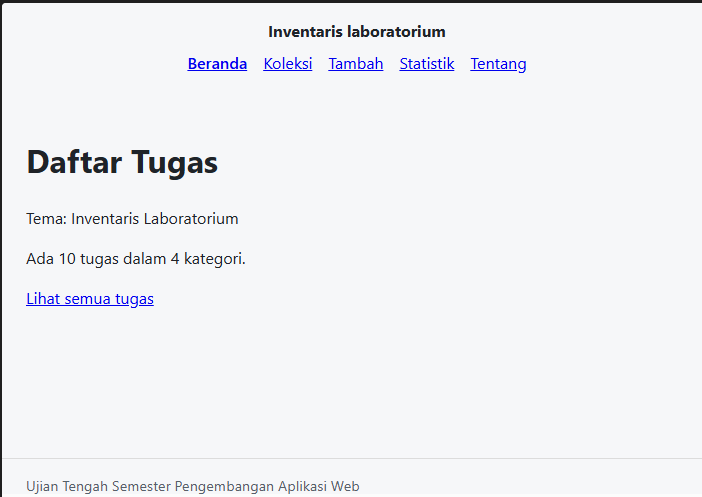
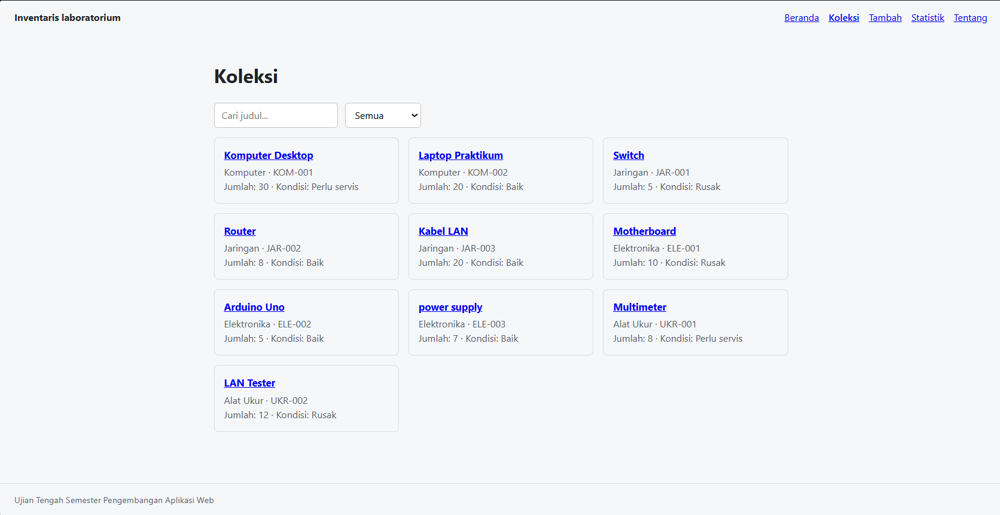
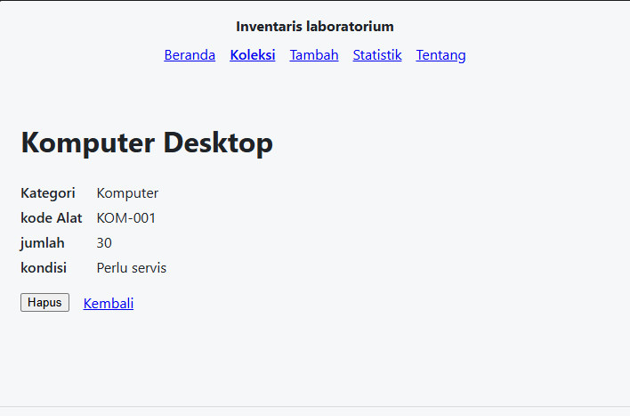
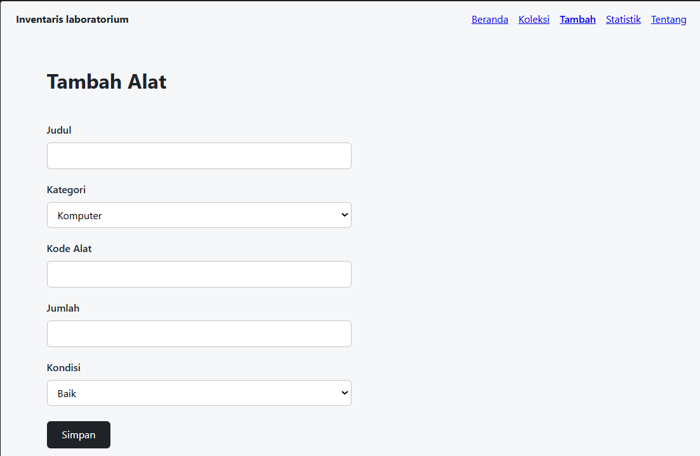

# Ujian Tengah Semester IF25-22014 Pengembangan Aplikasi Web

# Inventaris Laboratorium 

| Informasi | Detail |
| :--- | :--- |
| **Nama** | Wafi Ziqra Maulana |
| **NIM** | 124140043 |
| **Kelas** | RA |
| **Tema** | Inventaris Laboratorium |
| **Deployment** | https://ziqrawafi.github.io/uts-paw/ |

---
## Tangkapan Layar Aplikasi

| Halaman Beranda | Halaman Koleksi |
| :---: | :---: |
|  |  |
| *Gambar 1. Halaman Beranda* | *Gambar 2. Halaman Koleksi Buku* |

| Halaman Detail Buku | Halaman Tambah Buku |
| :---: | :---: |
|  |  |
| *Gambar 3. Halaman Detail Buku* | *Gambar 4. Halaman Form Tambah Buku* |

| Halaman Statistik | Halaman Tentang |
| :---: | :---: |
|  |  |
| *Gambar 5. Halaman Statistik Koleksi* | *Gambar 6. Halaman Tentang Aplikasi* |


---

## Fitur

- Menampilkan ringkasan dan daftar alat laboratorium dalam bentuk kartu.
- Pencarian alat berdasarkan judul dan filter berdasarkan kategori.
- Melihat informasi lengkap alat pada halaman detail.
- Menambahkan alat baru ke koleksi lewat formulir dengan validasi.
- Menghapus alat dari koleksi dengan konfirmasi.
- Menampilkan statistik jumlah alat berdasarkan kategori.
- Menampilkan identitas mahasiswa, tema, dan tautan repositori di halaman Tentang.
- Halaman 404 untuk alamat yang tidak dikenal.

---

## Menjalankan secara lokal

```bash
cd app
npm install
npm run dev
```

---

## Konsep React yang dipakai

- Components & Props: Memecah antarmuka menjadi komponen yang dapat dipakai ulang.
- State (useState): Mengelola state pada kotak pencarian, filter kategori, dan formulir.
- React Context (useContext & custom hook `useKoleksi`): Membagikan data koleksi ke semua halaman.
- Pengujian: Vitest dan Testing Library.