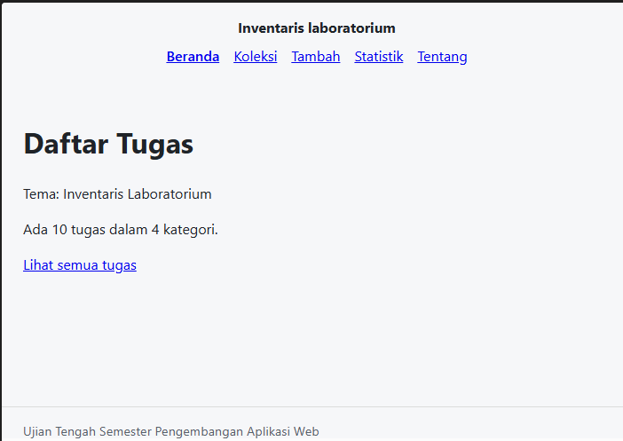
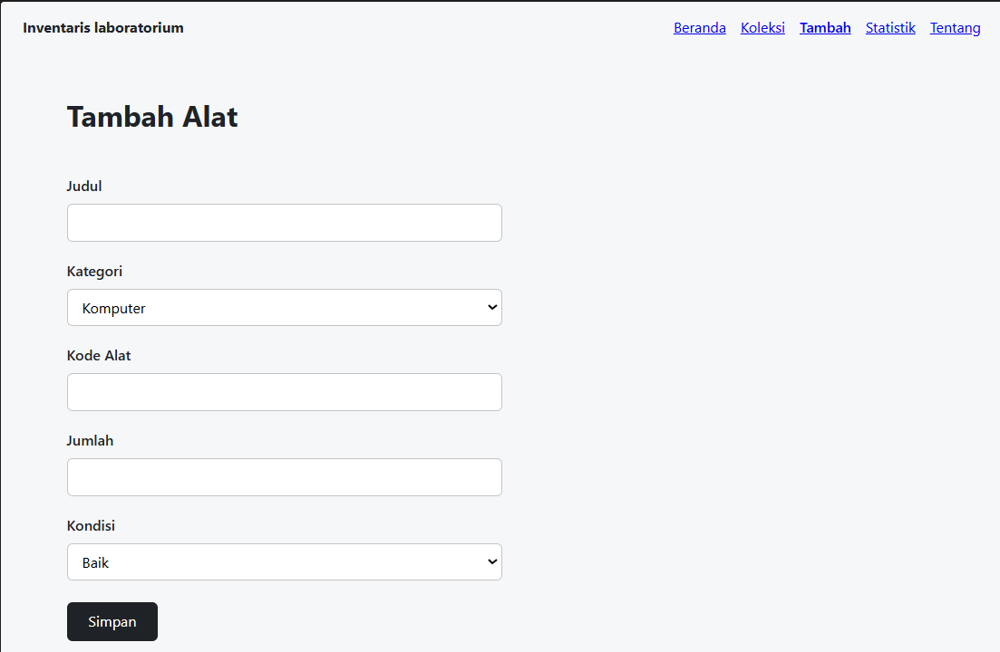
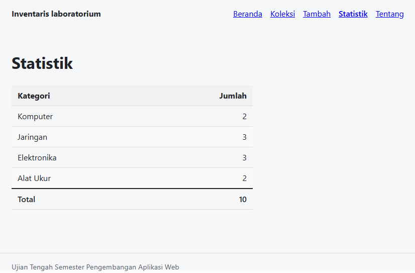
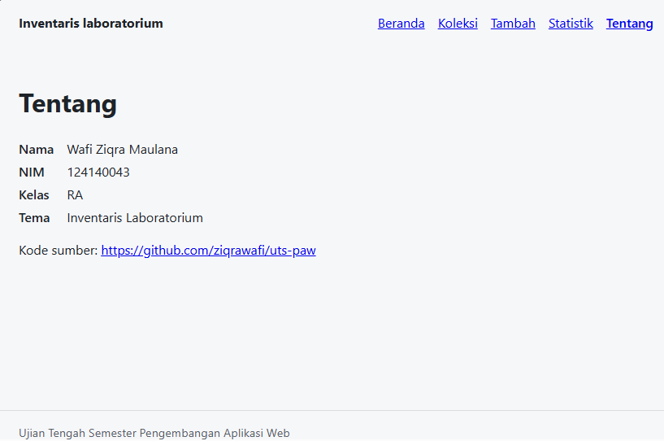

# Inventaris Laboratorium

Ujian Tengah Semester IF25-22014 Pengembangan Aplikasi Web

| Informasi | Detail |
| :--- | :--- |
| **Nama** | Wafi Ziqra Maulana |
| **NIM** | 124140043 |
| **Kelas** | RA |
| **Tema** | Inventaris Laboratorium |
| **Repositori** | https://github.com/ziqrawafi/uts-paw |

---

## Tangkapan Layar Aplikasi

| Halaman Beranda | Halaman Koleksi |
| :---: | :---: |
|  |  |
| *Gambar 1. Halaman Beranda* | *Gambar 2. Halaman Koleksi Alat* |

| Halaman Detail Alat | Halaman Tambah Alat |
| :---: | :---: |
|  |  |
| *Gambar 3. Halaman Detail Alat* | *Gambar 4. Halaman Form Tambah Alat* |

| Halaman Statistik | Halaman Tentang |
| :---: | :---: |
|  |  |
| *Gambar 5. Halaman Statistik Koleksi* | *Gambar 6. Halaman Tentang Aplikasi* |

---

## Fitur


---

## Menjalankan secara lokal

```bash
cd app
npm install
npm run dev
```

---

## Konsep React yang dipakai
